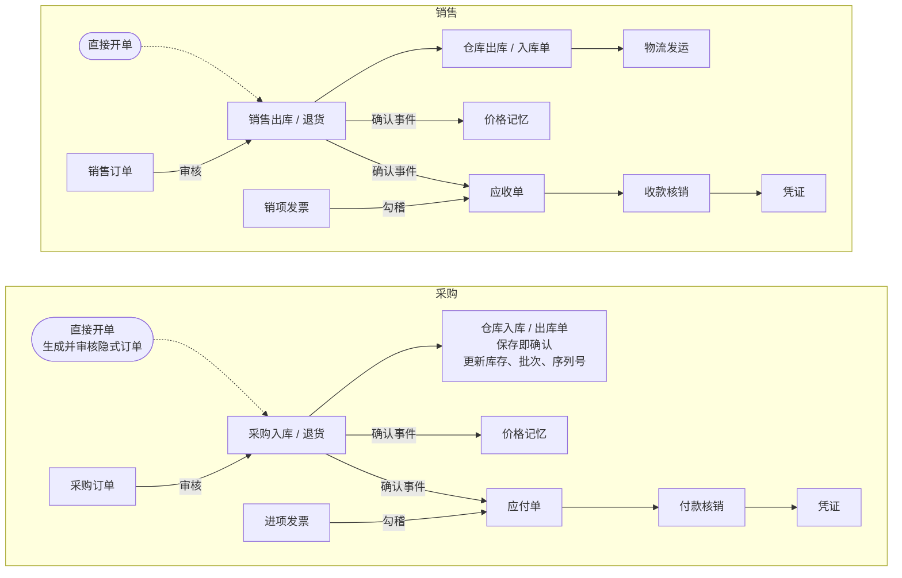
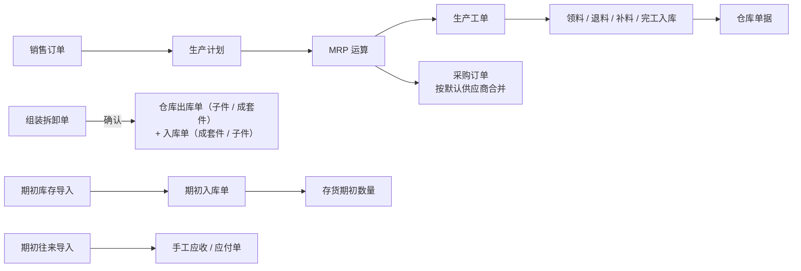
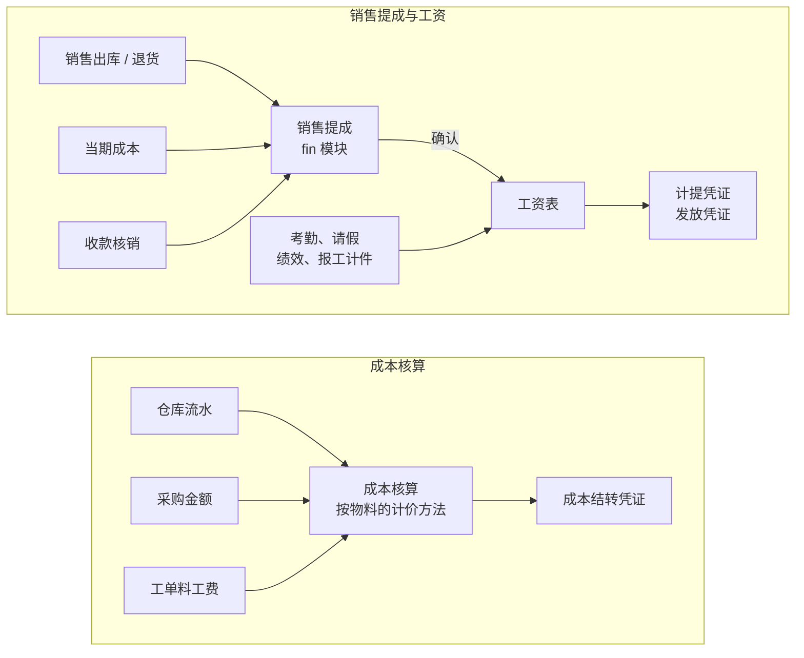
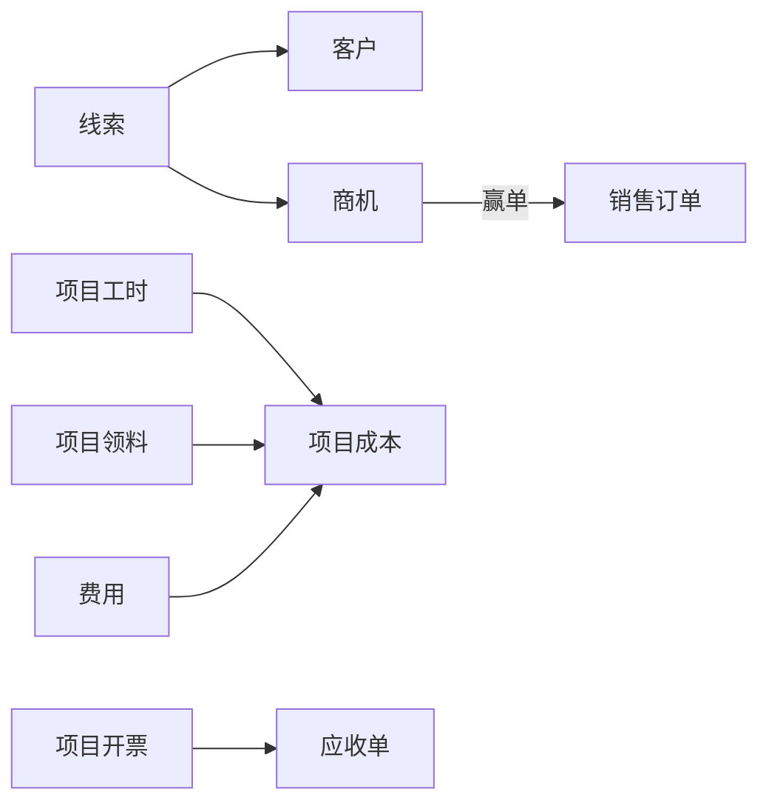
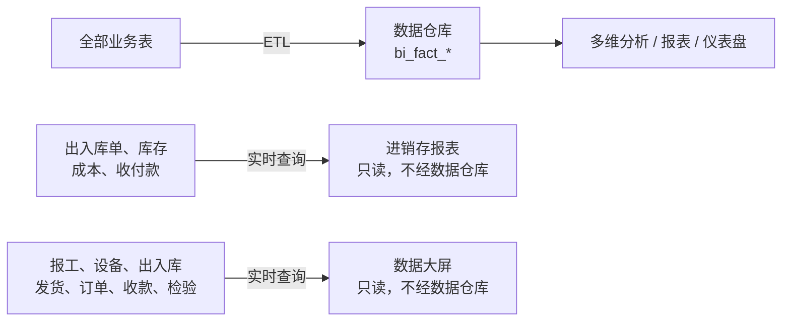
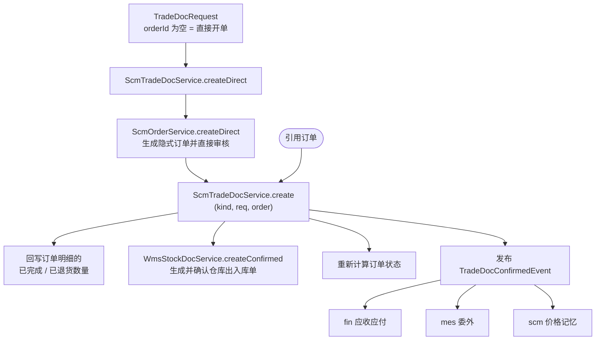
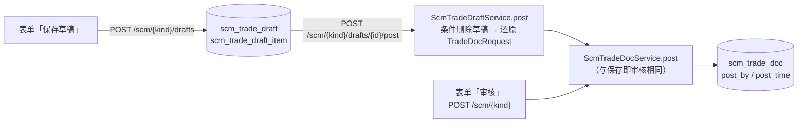

# 业务联动

ERP 的价值在于单据之间的自动联动：出入库更新库存、生成应收应付，业务单据生成凭证，审批结果回写单据。柠檬ERP 在模块单向依赖的前提下，用三种方式实现联动；无论哪种方式，**一个模块只写自己的表**，修改其他模块的数据必须调用所属模块的 Service 方法或通过 framework 的契约接口 / 事件。

## 三种联动方式

| 方式 | 适用场景 | 示例 |
| --- | --- | --- |
| 下游直接调用上游的 Service | 下游模块需要上游的能力 | 供应链的采购入库调用仓库的 `WmsStockDocService` 生成并确认入库单；所有模块调用 wms 的 `DocNoService` 取单据号 |
| 上游发布事件、下游监听 | 上游的业务动作需要触发下游的处理，上游不感知下游 | 采购入库确认后 scm 发布 `TradeDocConfirmedEvent`，fin 监听生成应付单；fin 删除凭证时发布 `VoucherDeletedEvent`，hr 的工资表监听后解除关联 |
| 框架层定义接口、下游实现 | 上游需要同步拿到下游的数据或能力 | scm 校验客户信用额度时注入 `PartnerBalanceProvider`，由 fin 实现；仓库等模块注入 `BizPeriodGuard` 检查会计期间，由 fin 实现 |

## 同步事件与事务

柠檬ERP 的领域事件都用 Spring 的 `ApplicationEventPublisher` 在业务事务中**同步**发布，监听方用 `@EventListener`：

```java
// fin（FinBillService）：出入库确认后生成应收 / 应付单，与出入库在同一事务
@EventListener
public void onTradeDocConfirmed(TradeDocConfirmedEvent e) {
    TradeKind kind = e.kind();
    BillKind billKind = kind.getOrderKind() == OrderKind.SALES ? BillKind.AR : BillKind.AP;
    ...
    billMapper.insert(bill);
}
```

事件中的种类、状态等字段直接用枚举类型（如 `TradeDocConfirmedEvent.kind()` 是 `TradeKind`），监听方不需要再从字符串转换。

- 监听器与发布方在同一事务中执行，监听器抛出异常会让整张单据回滚，保证账实一致（例如期间已结账时生成应付单失败，采购入库也不会成功）；
- 下游可以通过抛出 `BizException` 阻止上游的操作（例如销售订单反审核时发布 `OrderStatusChangedEvent`，已生成生产计划时监听方抛异常阻止反审核）；
- 只需在提交后执行的副作用（发消息、调用外部系统）用 `@TransactionalEventListener`。

### 下游处理后回写上游

下游处理上游的事件后，常常需要把生成的单据 ID 记回上游的单据（如发运单记录运费应付单）。下游**不能直接改写上游的表**（不注入上游的 Mapper，也不在自己的 mapper XML 中 `UPDATE` 上游的表），而是调用上游 Service 提供的方法，在同一事务中完成：

```java
// fin（FinBillService）：发运单发货后生成承运商运费应付单，再回写发运单
@EventListener
public void onShipmentShipped(ShipmentShippedEvent e) {
    FinBill bill = ...;
    billMapper.insert(bill);
    shipmentService.bindFreightBill(e.shipmentId(), bill.getId());
}

// scm（ScmShipmentService）：数据所属的模块提供回写方法，注释写明由谁、在什么时机调用
/** 记录发运单运费生成的承运商应付单。由财务模块在处理 ShipmentShippedEvent 时调用，与发货在同一事务 */
public void bindFreightBill(Long shipmentId, Long billId) {
    shipmentMapper.update(Wrappers.<ScmShipment>lambdaUpdate().set(ScmShipment::getFreightBillId, billId)
            .eq(ScmShipment::getId, shipmentId));
}
```

| 回写方法 | 所属模块 | 调用时机 |
| --- | --- | --- |
| `ScmShipmentService.bindFreightBill` / `bindFreightArBill` | scm | fin 处理 `ShipmentShippedEvent` 生成运费应付单 / 代垫运费应收单后 |
| `ScmTradeDocService.bindFreightBill` | scm | fin 处理 `PurchaseFreightEvent` 生成采购运费应付单后 |
| `ScmRebateService.bindBill` | scm | fin 处理 `RebateSettledEvent` 生成红字应收单（销售返利）/ 红字应付单（采购返利）后 |
| `QmsClaimService.bindBill` | mes | fin 处理 `SupplierClaimConfirmedEvent` 生成红字应付单后 |
| `MesEquipmentService.bindVoucher` / `unbindVouchers` | mes | fin 处理 `MaintenanceFinishedEvent` 生成费用凭证后 / 删除凭证时 |

mapper XML 中跨模块的**只读** JOIN（报表、商务智能、首页统计）允许保留。

## 事件清单

| 事件 | 定义位置 | 发布时机 | 监听方 |
| --- | --- | --- | --- |
| `TradeDocConfirmedEvent` | scm | 采购入库 / 退货、销售出库 / 退货确认（库存已更新） | fin 生成应付 / 应收单；mes 处理委外；scm 登记价格记忆（`ScmPriceMemoryService`） |
| `OrderStatusChangedEvent` | scm | 订单反审核、关闭等状态变化 | mes 检查或关闭生产计划；scm 释放库存预留 |
| `OrderDeletedEvent` | scm | 草稿订单删除 | crm 商机解除对订单的引用；scm 报价、询价、请购解除引用 |
| `ShipmentShippedEvent` | scm | 物流发运单首次发货 | fin 生成承运商运费应付单（本公司承担借 销售运费，客户承担借 代垫运费），客户承担时另生成代垫运费应收单，见[运费](#运费) |
| `PurchaseFreightEvent` | scm | 采购入库填写了运费 | fin 生成采购运费应付单（计入存货成本时借 存货，计入当期费用时借 采购运费科目 / 贷 应付账款），见[运费](#运费) |
| `RebateSettledEvent` / `RebateUnsettledEvent` | scm | 返利结算 / 撤销（红字单据方式；事件带 `kind`、`partnerId`） | fin 生成 / 删除红字应收单（销售返利）或红字应付单（采购返利） |
| `WorkOrderClosedEvent` | mes | 生产工单关闭 | mes 撤销未完成的补料申请 |
| `WorkOrderCompletedEvent` | mes | 生产工单完工（完工入库满数量，或已有完工入库且 完工 + 报废 达到工单数量而自动完工；与完工同一事务同步发布） | mes 撤销审批中、待发料的补料申请（审批中的同时撤销流程） |
| `MaintenanceFinishedEvent` | mes | 设备维修保养完成 | fin 生成费用凭证 |
| `SupplierClaimConfirmedEvent` / `SupplierClaimCancelledEvent` | mes | 供应商质量索赔确认 / 撤销 | fin 冲减应付 |
| `VoucherDeletedEvent` | fin | 删除凭证 | hr 工资表、培训，fin 资产、费用，pm 项目月结解除与凭证的关联 |
| `EmployeeLeftEvent` | framework/org | 人事异动（离职）生效 | system 停用账号；crm、pm 按交接人移交数据；workflow 移交待办；hr 处理劳动合同 |
| `EmployeeDeptChangedEvent` | framework/org | 员工调岗 | system 同步登录账号的部门 |
| `FlowFinishedEvent` | framework/workflow | 审批流程结束 | 各业务模块回写单据状态 |
| `FlowTaskAssignedEvent` | framework/workflow | 审批任务分配 | workflow 发送待办消息 |
| `OperLogEvent` / `LoginLogEvent` | framework/log | 操作 / 登录 | monitor 异步写入日志表 |

事件只在本模块内或下游使用时定义在本模块中（如 scm 的事件只有依赖 scm 的模块能监听）；需要被上游或平行模块监听的事件放在 framework 中（如 `EmployeeLeftEvent`：system、workflow 不依赖 hr）。

## 主要联动链路

下面按业务分几张图说明单据之间的自动联动：实线是保存 / 审核时自动生成，虚线是另一种录入方式，「确认事件」指出入库单确认后发布的 `TradeDocConfirmedEvent`（各模块监听后生成应收应付、登记价格记忆等）。

### 采购与销售



发票可以手工登记，也可以导入数电票 XML 或发票清单，勾稽后计入应收 / 应付单的已开票金额。

### 生产与库存



### 成本与薪酬



### 客户与项目



### 数据分析



联动的约定：

- 由业务单据生成的仓库单据**保存即确认**，`wms_stock_doc.source_no` 记录来源单号；库存不足、序列号不在库等错误会让整张业务单据回滚。
- 仓库的手工入库只能选「其他入库 / 寄售入库」，手工出库只能选「其他出库 / 报废出库」（`StockInType.MANUAL`、`StockOutType.MANUAL`，判断用 `StockDocType.isManual()`，校验在 `StockDocRules.checkManualType`）；采购、销售、生产、项目、委外等类型只由对应的业务单据生成，否则会绕过应收应付和成本归集。出入库单的类型下拉列出字典中的全部类型，业务单据生成的类型不可选并提示由哪种单据生成（前端 `components/wms/wms.js` 的 `AUTO_TYPE_SOURCES`，新增由业务单据生成的类型时同步登记）。出入库类型 `biz_type` 是系统字典，成本核算按它区分，不能由租户扩充。
- 收发类别（`wms_stock_doc.io_category`，可不填）：其他入库选「入库类别」（业务字典 `wms_in_category`），其他出库、报废出库选「出库类别」（`wms_out_category`），由 `StockDocType.ioCategoryDict()` 决定，保存时 `DictLookup.check` 按当前租户的字典校验；月末成本凭证按类别取对方科目（见下文「自动凭证的科目」）。
- 采购入库 / 退货、销售出库 / 退货、工单领料 / 退料 / 完工入库都是保存即确认，不能修改删除，错误通过退货、退料冲回（没有反审核）。采购入库 / 退货、销售出库 / 退货可以由业务参数「进销存单据先存草稿」改为先存草稿、审核后才出入库，见下文[草稿与审核](#草稿与审核)。
- 多规格物料的款式（`is_template = 1`）只用于生成 SKU 和按规格矩阵录入订单，`StockService.apply` 拒绝款式的库存变动，所有出入库都落在具体的 SKU 上。

- 组装拆卸单在仓库模块内完成：确认时在同一事务中生成并确认出入库单（出入库类型 `ASSEMBLY`，来源单号为组装拆卸单号），成本核算按子件成本结转成套件。
- 销售提成的代码在 fin（统计销售出库、成本、收款核销），工资表由 hr 直接调用 `FinCommissionService.confirmedAmounts(期间)` 取已确认的提成（hr 依赖 fin，属于「下游调用上游」）。

## 出入库单：直接开单、草稿、明细仓库与价格记忆

采购入库 / 退货、销售出库 / 退货（`scm_trade_doc`，`ScmTradeDocService.create`）有两种录入方式，最终都走同一条「按订单出入库」的链路（`ScmTradeDocService.post`，保存即审核和[草稿审核](#草稿与审核)共用）。单据按订单明细录入，可拆成多个库位、批次；回写订单明细的已完成 / 已退货数量用条件更新，不会超收超发；单价取订单。保存即审核：出入库、生成应收应付，并记录审核人 `post_by` / 审核时间 `post_time`；审核后不能修改、删除，错误的单据通过退货冲回（没有反审核）：



### 直接开单与隐式订单

业务参数 `scm.directDoc.enabled`（`ScmBizRules.DIRECT_DOC`，默认开启）打开时，`TradeDocRequest.orderId` 可以为空（`req.direct()`）。此时请求填写往来单位 `partnerId`、销售出库的业务员 `salesmanId`（可空），明细 `TradeDocItemRequest` 填写 `materialId`、`price`（含税单价）、`taxRate`，不填 `orderItemId`。

`ScmTradeDocService.createDirect` 的处理：

1. 参数关闭时抛 `scm.error.directDocDisabled`；没有往来单位、某行没有物料或单价时报错；直接开单的退货不支持补发 / 补收（`replenish`）。
2. 每行明细转为一行 `OrderItemRequest`，调用 `ScmOrderService.createDirect(kind, req, salesmanId, returns)`。该方法声明为 `@Transactional(propagation = Propagation.MANDATORY)`，只能在出入库单的事务中调用：
   - 与手工订单共用 `insertDraft`：套用采购合同价、校验限价（`checkPriceLimit`）；销售出库应用折扣、满减促销（`applied.withoutGifts()` 去掉买赠的赠品行，赠品不会随单出库），按业务参数校验信用额度（`creditChecker.checkOnApprove`）；业务员为空时取客户负责人，没有时为制单人；
   - `approveDirect` 直接审核，不走审批流程；
   - 退货（`returns = true`）时 `ScmOrderItemMapper.markAllDone` 把隐式订单的明细视为已全部出入库，只用于回写退货数量。
3. 按插入顺序把隐式订单明细与请求明细一一对应，填上 `orderItemId`（销售出库保留各行的 `warehouseId`），再调用引用订单时的 `create(kind, req, order)`。

因此信用额度、限价、促销、超发比例、序列号批次、应收应付、成本、提成、追溯、BI 都与引用订单完全相同，不需要为直接开单另写一套联动。隐式订单出现在订单列表中（标记「直接开单」），但随出入库单生成、已全部完成，**不能反审核、关闭、变更、预留、发货通知**：这些入口都先调用 `ScmOrderService.checkNotDirect(order)`（抛 `scm.error.directOrderReadOnly`），错误通过退货冲回。新增针对订单的操作时，同样要先调用 `checkNotDirect`。

客户寄售结算（`ScmConsignService`，来源 `CONSIGN`）也是「先生成已审核订单、再按订单出库」的做法，直接开单与它一致。

退货有两种方式：前端选择原出入库单时带出其订单（请求中 `orderId` 不为空，按原订单回写退货数量）；不选原单时为直接开单，生成的隐式订单只用于回写退货数量，库存按退货入库 / 出库，应收应付按退货金额冲减。

### 草稿与审核

业务参数「进销存单据先存草稿」（`scm.tradeDoc.draft`，`ScmBizRules.TRADE_DRAFT`，默认关闭，前端可读，issue #68）开启后，采购入库、采购退货、销售出库、销售退货（含直接开单）的表单底部为「保存草稿」「审核」。做法参照收付款草稿（`fin.settlement.draft`，见 [应收应付核销开发](../guide/settlement#草稿与确认)）。



**草稿单独建表，不在 `scm_trade_doc` 上加状态**。`scm_trade_doc` 被约 40 处查询直接读取（库存成本、订单执行、应收应付、提成、商务智能、进销存报表、追溯、客户关系、项目成本等），这些查询都默认它是已生效的单据；如果把草稿放进去，每处跨模块查询都要加状态过滤，漏掉一处就会让草稿影响报表或成本，以后新写的查询也要记得加。草稿单独存放在 `scm_trade_draft` / `scm_trade_draft_item`（`ScmTradeDraftService`，接口 `/scm/{kind}/drafts`，`ScmTradeDraftController`）后，在结构上就不会出现在任何业务数据里，可修改、删除：

- 明细按列保存（不存 JSON），详情一次 JOIN 带出物料、库位信息，表单直接回显；`source_doc_id` 记录退货引用的原出入库单（只用于回显），订单优惠、运费、业务员、整单优惠、补发标识都保存在草稿表头；
- 登记到 `ScmRefMapper`，被草稿引用的物料、仓库、往来单位、承运商、用户、部门不能删除（提示「出入库草稿」）；
- 保存时就占用单据号（`DocNoService.next`，与订单、仓库单据的草稿一致），审核后出入库单沿用这个单号；
- **只校验结构**：引用订单时订单可见、明细属于该订单（物料取订单明细）；直接开单有往来单位、每行有物料；运费只用于采购入库，赠品只用于销售出库，直接开单的退货不能补发，订单优惠只用于引用订单的采购入库。库存、可入库数量等在审核时才校验，因为草稿本来就是「还没确认」的内容。合计金额按订单单价 / 录入单价估算（直接开单扣除整单优惠），列表标为「金额（估算）」；
- 草稿按制单人部门 + 制单人做数据权限（`DataScopes.require`），种类不符视为不存在（`scm.error.tradeDraftNotFound`）。

**审核复用原有出入库流程**：`POST /scm/{kind}/drafts/{id}/post`（权限 `scm:{kind}:post`；带请求体时先按其修改草稿，需同时有新增权限）调用 `ScmTradeDraftService.post`，在一个事务中：

1. 先条件删除草稿（`deleteById` 返回 0 说明已被审核或删除，抛 `scm.error.tradeDraftNotFound`），并发审核同一张草稿只有一个成功；
2. 把草稿还原为 `TradeDocRequest`，调用与保存即审核相同的 `ScmTradeDocService.post(kind, req, origin)`。库存、信用额度、限价、促销、可入库数量、订单优惠都按审核当时的数据校验，任一项失败整体回滚，草稿保持不变。所以库存、应收应付、成本、凭证的规则只有一套；
3. `Origin(docNo, createBy, deptId)` 让出入库单沿用草稿的单据号、制单人、制单部门（数据权限不变），审核人 `post_by` 为当前用户、`post_time` 为审核时间（详情显示「审核」行；升级前的单据回填为制单人、创建时间）。直接开单的销售出库没有指定业务员时取客户负责人，没有负责人时取草稿制单人，不取审核人。

**权限**：`scm:{purchaseIn,purchaseReturn,salesOut,salesReturn}:post`（菜单 1411 / 1421 / 1441 / 1451），内置角色中采购员（采购两种）、仓库管理员、会计有。保存、修改、删除草稿用新增权限；开启草稿后直接「保存并审核」（`POST /scm/{kind}`，`ScmTradeDocController` 中判断）也需要审核权限，否则抛 `scm.error.noPermissionPostTrade`；只有审核权限的人可以审核草稿但不能改内容。关闭时保存即审核、只需新增权限（与原来一致），不能新建草稿（`scm.error.tradeDraftDisabled`），已有草稿仍可修改、审核、删除。

**审核后不能修改**：沿用现有做法，错误的单据通过退货冲回，不加反审核。反审核要回退库存、批次序列号、订单数量、应收应付、成本和凭证，风险大；而草稿已经解决了「先存、确认后再生效」的需求。

**其他入口**：

- 列表页（`TradeDocPage.vue`）在参数开启或有草稿时显示「已审核」「草稿（N）」页签（`?tab=draft` 直接打开），草稿列表 `TradeDraftTable.vue` 的操作为编辑、审核、删除；表单 `TradeDocForm.vue` 用 `FormDrawer` 的 `actions` 插槽放两个按钮，`useFormDrawer` 的 `successMessage` 传函数按保存方式提示；
- 首页待办（`ScmTodoProvider`）对有审核权限的用户显示各类待审核的草稿数量，链接到草稿页签；
- 移动作业的扫码收货、小程序的扫码收货和快速开单在开启草稿且没有审核权限时调用草稿接口保存为草稿；
- 发货通知拣货出库、ASN 收货、寄售结算等由其他业务生成的出入库单各自已有确认步骤，仍直接审核（直接调用 `ScmTradeDocService.create`，不经过草稿，也不检查审核权限）。

### 销售出库的明细仓库

业务参数 `scm.salesOut.lineWarehouse`（`ScmBizRules.SALES_OUT_LINE_WAREHOUSE`，默认开启）打开时，销售出库的每行可以另选仓库。**一张出入库单仍然只生成一张仓库单据**，仓库落在明细上：

- `scm_trade_doc_item.warehouse_id`、`wms_stock_doc_item.warehouse_id` 只在与表头仓库不同时保存，为空表示取表头仓库（`ScmTradeDocService` 中设置，`WmsStockDocService.toItems` 再次规范化；调拨单忽略明细仓库）；
- 仓库模块按「明细仓库，为空取表头仓库」处理：库存变动 `StockDocRules.toChanges` 用 `item.warehouseOr(doc.getWarehouseId())`，`StockDocValidator` 对明细仓库同样校验启用状态和寄售仓类型，库位必须属于本行的仓库；冲销（`StockDocReverser`）复制明细仓库；
- 库存预留按本行仓库核销（`reservationService.consume(orderItemId, 本行仓库, qty)`）；
- SQL 中一律写 `COALESCE(i.warehouse_id, d.warehouse_id)`：仓库单据明细、按仓库筛选单据（明细仓库匹配也算）、BI 的事实表、进销存报表都是这样；
- 采购入库、采购退货、销售退货只有表头仓库（参数只对销售出库生效，其他种类传入的 `warehouseId` 被忽略）。

新增按仓库统计出入库的查询时，记得用 `COALESCE(明细仓库, 表头仓库)`，否则从其他仓库出库的行会被算到表头仓库。

### 价格记忆

`ScmPriceMemoryService` 监听 `TradeDocConfirmedEvent`（`@EventListener`，与出入库**同一事务**），只处理销售出库、采购入库：读取单据明细，按 往来单位 × 物料 登记最新价（同一物料多行取最后一行）、最低价、最高价及各自日期，写入 `scm_price_memory`（种类 `SALES` / `PURCHASE`）。

- 退货不登记，单价为 0 的行（赠品）不登记；
- 价格为出入库明细的优惠前单价 `COALESCE(gross_price, price)`（含税、本位币）：整单优惠只在合计处扣减，不改变价格体系，见[整单优惠 - 显示口径](../guide/order-discount#显示口径-不改变价格体系)；促销、返利抵扣直接改变单价，按改变后的记；
- 按物料 ID 顺序逐个执行 `ScmPriceMemoryMapper.upsert`（`INSERT ... ON DUPLICATE KEY UPDATE`，唯一键 `kind + partner_id + material_id + tenant_id`），并发确认不会丢失更新，固定的加锁顺序避免死锁；单据日期不早于原最新日期时才更新最新价。

价格记忆是开单默认价的来源之一（销售的「最近售价」、采购的「最近进价」），也是价格参考中「客户对比」「供商对比」的数据，见 [开单取价与价格参考](../guide/pricing)。

## 运费

运费分两处登记，承担方用系统字典 `scm_freight_bearer`（`scm/model/FreightBearer`：`COMPANY` 本公司承担、`CUSTOMER` 客户承担（代垫）、`SUPPLIER` 供应商代垫）：

**发运单（销售运费）**：`scm_shipment.freight_bearer`（`COMPANY` / `CUSTOMER`，默认 `COMPANY`）。首次发货且运费大于 0、指定了承运商或客户承担时，`ScmShipmentService` 发布 `ShipmentShippedEvent(…, customerId, bearer)`，`FinBillService.onShipmentShipped` 在同一事务中：

- 指定了承运商时生成承运商应付单（来源 `SHIPMENT`），费用科目本公司承担取 `AccountRole.SALES_FREIGHT`（默认 6601）、客户承担取 `FREIGHT_ADVANCE`（默认 1221 其他应收款），凭证 借 该科目 / 贷 应付账款，回写 `bindFreightBill`；
- 客户承担时另生成客户的代垫运费应收单（来源 `SHIPMENT`，不含税），凭证 借 应收账款 / 贷 代垫运费，与应付侧借记的代垫运费相抵，不是销售收入、不影响毛利，回写 `ScmShipmentService.bindFreightArBill`（`scm_shipment.freight_ar_bill_id`）。

已生成任一单据后不能再修改运费、承担方和承运商（前端 `billed`，后端比较旧值）。

**采购入库（采购运费）**：`TradeDocRequest.freight / freightBearer / carrierSupplierId`，`ScmTradeDocService.checkFreight` 校验只能是采购入库（`scm.error.freightOnlyPurchaseIn`）、承担方只能是 `SUPPLIER`（默认）或 `COMPANY`（`freightBearerInvalid`），`COMPANY` 必须选承运商（`freightSelectCarrier`，前端下拉只列出物流公司，后端不限制承运商的类型，见下文[承运商](#承运商)）。两种承担方都只生成一张采购运费应付单，不另生成费用支出单，运费只计一次。

**入账方式**（`scm_trade_doc.freight_cost`，`scm/model/PurchaseFreightCost`，入库时确定并记在单据上，之后修改参数不影响已有单据）：供应商代垫的始终为 `INVENTORY`（随货款付给供应商，本质上是采购价格的一部分）；本公司承担的按业务参数「本公司承担的采购运费计入」（`scm.purchaseFreight.cost`，前端可读，见 [业务参数](../guide/biz-rule)）：

- `INVENTORY` 存货成本（默认，企业会计准则的一般做法）：运费由 `ScmFreights.allocate(freight, 各行不含税金额, 各行数量)` 按金额比例分摊到 `scm_trade_doc_item.freight_share`（尾差放在金额最大的一行，金额合计为 0 时按数量），计入实时库存成本和月末成本核算的采购金额；
- `EXPENSE` 当期费用（商品流通企业进货费用金额较小时的简化做法）：不分摊（`freight_share` 为 0，存货成本不含运费），应付单记录费用科目 `AccountRole.PURCHASE_FREIGHT`「采购运费（本公司承担、计入当期费用时）」（默认销售费用 6601，与销售运费分开设置）。

单据记录 `freight`、`freight_bearer`、`freight_cost`、`carrier_supplier_id`，并发布 `PurchaseFreightEvent`（同一事务）：

- `ScmStockCosts`：采购入库的实时成本单价 = (行不含税金额 + `freight_share`) / 数量；采购退货仍按退货单价冲减（运费不退）；
- 月末成本核算：`FinCostSourceMapper` 的出入库汇总 `net` 加上 `freight_share`（其他种类为 0），计入采购金额；
- `FinBillService.onPurchaseFreight` 生成运费应付单（来源 `BillSource.PURCHASE_FREIGHT`，字典 `fin_bill_source`「采购运费」），应付对象为供应商（代垫）或承运商（本公司承担），回写 `ScmTradeDocService.bindFreightBill`（`freight_bill_id`）；凭证：计入存货成本时 借 存货（`FinBillMapper.selectFreightByCategory` 按物料分类汇总 `freight_share`，最后一个分类取差额）/ 贷 应付账款，计入当期费用时 借 `PURCHASE_FREIGHT` 科目（带部门）/ 贷 应付账款-承运商。

前端 `TradeDocForm.vue` 按「运费付给」和参数显示实际入账方式的提示（供应商代垫 / 本公司承担计入存货成本 / 本公司承担计入当期费用），`TradeDocDetail.vue` 显示「计入存货成本 / 计入当期费用」。

### 承运商

供应商资料的「物流公司（承运商）」标识（`scm_supplier.logistics`，可填写营运路线 `routes`）：采购入库本公司承担运费的承运商、发运单的运费结算供应商只列出物流公司（`PartnerSelect` 的 `carrier` 属性 → `GET /scm/supplier/carrier-options`，返回 `{ marked, options }`；还没有标记任何物流公司时回退到全部供应商并在下拉中提示去标记），供应商列表可按类型筛选、名称旁显示「物流公司」标签。物流公司复用供应商档案（编号、名称、联系人、电话、地址、备注都已有），应付、付款、对账、往来汇总与其他供应商相同，后端不限制所选承运商的类型（issue #68）。用标识而不是「供应商 / 协作单位」二选一的类型，是因为有的供应商既供货又帮忙送货，两种用途都能选到它。

## 自动凭证的科目

业务单据生成凭证（应收应付、收付款、预收预付、票据、费用报销、借款、资产折旧、工资、成本结转、期末结转、项目月结等）时，科目不写死编码，一律由「凭证科目设置」决定：

```java
// pm 项目月结：合同履约成本、工资费用（按职位类别）
Long contractCost = accountRules.accountId(AccountRole.CONTRACT_COST);
Long expense = accountRules.accountId(AccountRole.SALARY_EXPENSE, positionCategory);
```

- `fin/model/AccountRole` 枚举列出全部用途（分组：往来、存货与成本、收入与费用、税费、资产、薪酬、期末），每个用途带默认科目编码（`init.sql` 预置的科目）；存货（`INVENTORY`）、主营业务收入（`REVENUE`）、主营业务成本（`COST_OF_SALES`）可按物料分类，工资费用（`SALARY_EXPENSE`）可按职位类别，其他入库 / 其他出库的对方科目（`OTHER_IN_OFFSET` / `OTHER_OUT_OFFSET`）可按收发类别（维度 `IN_CATEGORY` / `OUT_CATEGORY`）分别设置；用途可声明后备用途（`AccountRole.fallback()`），没有任何设置时沿用后备用途的科目（其他出入库对方科目 → 待处理财产损溢 `PENDING_LOSS`）；
- `FinAccountRuleService.accountId(用途[, 维度取值])` 的取值顺序：用途 + 维度取值的设置 → 用途的设置 → 默认科目编码（带维度的用途还可以按维度给默认值，如半成品、成品的存货默认为库存商品 1405，低值易耗品为周转材料 1411；生产岗位的工资费用为制造费用 5101，销售岗位为销售费用 6601）；
- 设置保存在 `fin_account_rule`（按租户），设置的科目必须是启用的末级科目，被设置引用的科目不能删除、不能增加下级；修改只影响之后生成的凭证；
- 其他模块（hr 工资、pm 项目月结等）同样注入 `FinAccountRuleService` 取科目；新增自动凭证的用途时在 `AccountRole` 中登记，「凭证科目设置」页面自动列出；
- 科目范围用途（`AccountRole.scope()`：库存现金 `CASH` 1001、银行存款 `BANK` 1002）设置的是一个科目及其全部下级，可以是上级科目：结算账户校验、银行对账、出纳日记账、现金流量表、资金计划按 `FinAccountService.cashCodes()` / `roleCode(用途)` 识别，前端 `AccountSelect` 用 `:roles="['CASH', 'BANK']"` 限定可选科目；Java 代码中不写科目编码，只有报表格式（资产负债表、利润表模板，现金流量表按一级科目归类）按企业会计准则的编码前缀定义。

凭证分录的辅助核算（部门、客户、供应商、项目、存货）在「会计科目」上设置（`fin_account.aux_items`，可多选，下级默认沿用上级），分录上各占一列（`dept_id`、`customer_id`、`supplier_id`、`project_id`、`material_id`），可同时填写。手工凭证使用设置了辅助核算的科目时对应项目必填；业务生成的凭证按单据自动带出客户、供应商等，不受科目设置约束。

## 存货计价

成本核算按物料上设置的计价方法（`wms/model/CostMethod`）计算出库成本。代码在 `fin/service/cost`：`FinCostService` 只做期间校验、编排和保存，取数 `CostSourceLoader`（查询结果转为强类型的 `CostSource`），计算 `CostCalculator`（纯计算，不依赖 Spring），凭证 `CostVoucherWriter`；填写了收发类别的其他出入库按「数量 × 本期单价」拆出，按类别的对方科目生成凭证。

| 计价方法 | 说明 |
| --- | --- |
| `WEIGHTED` 月末一次加权平均（默认） | 本期出库按（期初 + 本期入库）的平均单价计价 |
| `MOVING` 移动加权平均 | 按出入库发生顺序逐笔计价（`cost/MovingValuation`），每次入库后重算平均单价 |
| `FIFO` 先进先出 | 按发生顺序逐笔计价（`cost/FifoValuation`），出库先消耗最早的批次；期末结存批次保存在 `fin_cost_layer`，作为下一期的期初批次 |

逐笔计价的两种方法共用 `Valuation` 接口（按金额入库、按当前成本入库、出库、采购退货冲减、期末结存）。逐笔计价得到期末结存后，本期出库总成本 = 期初 + 本期入库 − 期末结存，再按数量分摊到生产领用、销售、其他出库，因此凭证、工单材料成本与月末加权的处理方式一致。修改计价方法从下一次核算生效；撤销核算时一并删除当期的先进先出批次。

## 多实现的扩展接口

以下接口由每个业务模块各自实现、由框架或系统模块统一汇总，新模块按需实现即可接入对应的平台功能：

| 接口 | 汇总方 | 作用 | 示例 |
| --- | --- | --- | --- |
| `todo.TodoProvider` | dashboard（首页待办） | 按当前用户权限返回待处理事项，数量为 0 的不显示 | `WmsTodoProvider`（数量在 `WmsTodoMapper.xml` 中一次查询） |
| `job.JobHandler` | system（`SysJobService`） | 定时任务 | `WmsBatchExpiryJob` |
| `record.RecordTypeProvider` | system（附件、变更历史、自定义字段） | 登记可挂附件、记录变更历史、扩展自定义字段的业务类型 | `WmsRecordTypes` |
| `ref.ReferenceChecker` | `ReferenceGuard` | 删除物料、仓库、客户、供应商、用户、部门前检查本模块单据是否引用 | 每个模块一个 `XxxReferenceChecker` + `XxxRefMapper.xml` |
| `tenant.TenantInitializer` | system（新建租户） | 新租户基础数据 | `FinTenantInitializer` |
| `rule.BizRuleProvider` | system（`SysBizRuleService`，「业务参数」页面） | 登记本模块按租户配置的业务控制规则 | `ScmBizRules`、`FinBizRules` |
| `DocNoCatalog`（Bean） | 编码规则页面 | 声明本模块的单据编号类型 | `ScmDocNos` |
| `FlowBusiness`（Bean） | workflow | 声明本模块接入审批的流程及流程变量 | `ScmFlowBusinesses` |

### 主数据删除保护

删除主数据前调用 `ReferenceGuard.checkDeletable`，任一模块报告有引用时拒绝删除（提示「已被 XX 使用，不能删除，可以停用」）：

```java
// 第三个参数是显示在提示中的名称，按请求语言取（wms.text.material=物料「{0} {1}」）
referenceGuard.checkDeletable(RefType.MATERIAL, id, Messages.get("wms.text.material", material.getCode(), material.getName()));
```

`ReferenceChecker.findReference` 返回的是引用它的单据名称的**消息键**（由实现的模块登记），`ReferenceGuard` 用 `Messages.get` 取消息后拼成提示。

上游模块（如仓库）看不到下游模块（如生产、客户关系）的表，因此由下游模块实现 `ReferenceChecker`。新增业务表引用主数据时，在本模块的 `XxxRefMapper.xml` 中加一条查询。

### 站内消息

注入 `MessageSender` 发送站内消息，在业务事务中调用，事务回滚时消息一并回滚：

```java
messageSender.sendToPermission("wms:stock:list", Message.of(MessageCategory.REMIND,
        "批次即将到期：" + code, "有效期至 " + expiryDate, "/wms/trace") // i18n-ignore 站内消息存库
        .dedup("batch-expiry:" + materialId + ":" + batchNo));
```

站内消息存入数据库并推送到钉钉等平台，标题和内容保持中文，不按触发用户的语言生成（见 [国际化](../guide/i18n)）。

| 方法 | 说明 |
| --- | --- |
| `send(userIds, message)` | 发送给指定用户 |
| `sendToPermission(perm, message)` | 发送给拥有该权限的全部启用用户；没有人拥有时发给超级管理员 |
| `Message.of(category, title, content, link)` | `category` 为枚举 `framework/message/MessageCategory`（字典 `sys_message_category`）：`APPROVAL` 审批、`REMIND` 提醒、`ALERT` 预警、`SYSTEM` 系统；`link` 为点击后跳转的前端路由 |
| `message.dedup(key)` | 同一用户已有相同去重键的消息时不再发送（定时提醒每天只发一次） |

站内消息写入后，`SysMessageService` 发布 `MessageSentEvent`，事务提交后由 `SysImPushService` 异步推送给已绑定的钉钉 / 企业微信 / 飞书成员，并按类别发到群机器人；`link` 会转为平台客户端内的免登链接；审批类消息同时由 `SysMiniappPushService` 推送为微信小程序订阅消息（见 [微信小程序开发](../guide/miniapp#审批提醒-订阅消息)）。业务代码不需要额外处理，见 [第三方集成](./im#消息推送)。
